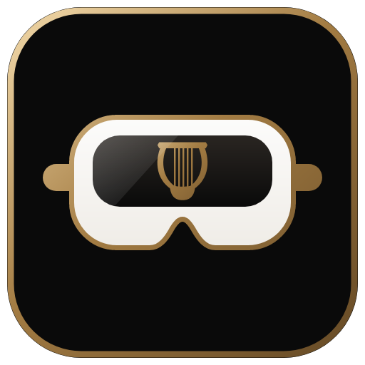

<p align="center"></p>

# Lyrenne VR

[Lyrenne](https://github.com/Doctordefector/Lyrenne) on your wrist, inside any PC VR game. Look at
your wrist and the player appears: the song, the cover, the current line of synced lyrics. Point
at it with your other controller and pull the trigger to play, pause, skip, seek, change the
volume, shuffle or repeat.

Works in games that run through **SteamVR** and in games that run on **Virtual Desktop's VDXR**
OpenXR runtime, so you don't have to change how you launch anything.

## Install

Download `LyrenneVR-Setup-x.y.z.exe` from [Releases](https://github.com/Doctordefector/Lyrenne-VR/releases)
and run it. It asks for admin once (the OpenXR layer has to be registered machine-wide), installs to
`Program Files\Lyrenne VR`, and starts the tray app. Nothing else to install: the app carries its
own .NET runtime.

Uninstall from Windows' Settings > Apps like anything else. Your settings stay in
`%LOCALAPPDATA%\LyrenneVR`.

Windows 10 or 11, 64-bit games.

## Using it

- **Open:** raise your watch hand (left by default) and look at your wrist. The player opens, with
  a faint tick on that hand, and closes when you look away. The text keeps itself level to your
  eyes however you hold your arm.
- **Click:** point your other controller at the player. A cursor follows the laser; nearby buttons
  pull it in, and you feel a light tick as it moves onto one. Pull the trigger to click, hold it
  to drag the seek bar or volume. While you point at the player, the game does not get the
  trigger, so clicking never fires your gun. Point away and the game has it back.
- **Volume** changes Lyrenne's own volume in the Windows mixer, never the game's.
- If Lyrenne isn't playing, it follows whatever player Windows shows in its media controls,
  unless you tick *Only follow Lyrenne*.

The tray icon has the rest: which wrist, when to show it, lyrics, vibration, a desktop preview,
and *Adjust position and size* with live sliders. Logs and settings live in
`%LOCALAPPDATA%\LyrenneVR`; the layer log names every game it loaded into.

## How it works

```
 Lyrenne ── Windows media controls ──┐
                                      │
                         LyrenneVR.exe (tray app)
        draws the panel, glance and pointer logic, lyrics (LRCLIB), covers (iTunes)
              │                                        │
        shared memory                           OpenVR overlay
              │                                        │
  OpenXR layer inside the game                  SteamVR games
  (VDXR, and other OpenXR runtimes)
```

- **LyrenneVR.exe** reads what's playing from Windows' media controls, which Lyrenne publishes to.
  Lyrenne itself needs no changes.
- **Under SteamVR** the player is an OpenVR overlay on your controller. Its trigger action set runs
  at overlay priority while you point at the player, which is what keeps the game from seeing
  the click.
- **Under VDXR** SteamVR never runs, so an overlay can't show. An implicit OpenXR API layer
  (`XR_APILAYER_LYRENNE_wrist_player`) loads into the game instead. It adds a pose action set to
  the game's input and a high-priority click set that is only active while you point at the player.
  It draws the player and the cursor as quads locked to your wrist, so they cost the game almost
  nothing. Under SteamVR's own runtime the layer stays out of the way, so you never get two.
- When LyrenneVR.exe isn't running, the layer does nothing beyond one timer check per frame.

## Building

Needs Visual Studio (C++ x64 build tools) and the .NET 9 SDK.

```
.\build.ps1 -Test
```

builds the layer, the app and `dist\LyrenneVR-Setup-x.y.z.exe`, and runs:

- `LyrenneVR.exe --selftest`: glance, pointer, trigger and artwork logic, driven with synthetic
  head and hand poses for both wrists.
- `build\test\xrtest.exe d3d11|d3d12|d3d11-deadclick`: the official Khronos loader, the real layer
  and a mock OpenXR runtime with real D3D11 and D3D12 swapchains. It checks the action set merge,
  the trigger capture, the wrist lock, the cursor quad and the panel's pixels read back from the GPU.

`LyrenneVR.exe --bench` measures redraw cost while the cursor moves; `--render out.png --demo`
draws one frame to a file.

## Limits

- The layer draws into D3D11 and D3D12 games, which covers Unity, Unreal and most others. Vulkan
  and OpenGL OpenXR games get no player yet.
- Native Oculus SDK games go through Virtual Desktop's LibOVR shim, not OpenXR or SteamVR, so they
  get no player.
- Like OpenKneeboard and OpenXR Toolkit, the layer is a DLL inside the game. Games with strict
  anti-cheat might object. To keep it out of one game, set
  `DISABLE_XR_APILAYER_LYRENNE_wrist_player=1` in that game's environment.

## Credits

Lyrics from [LRCLIB](https://lrclib.net). Covers from the iTunes Search API. Bundles the OpenXR
headers (Apache 2.0), OpenVR (BSD 3-Clause) and SkiaSharp (MIT).
